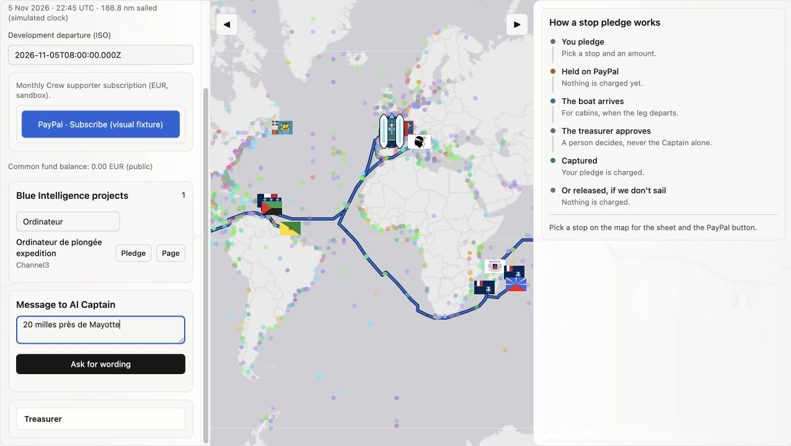
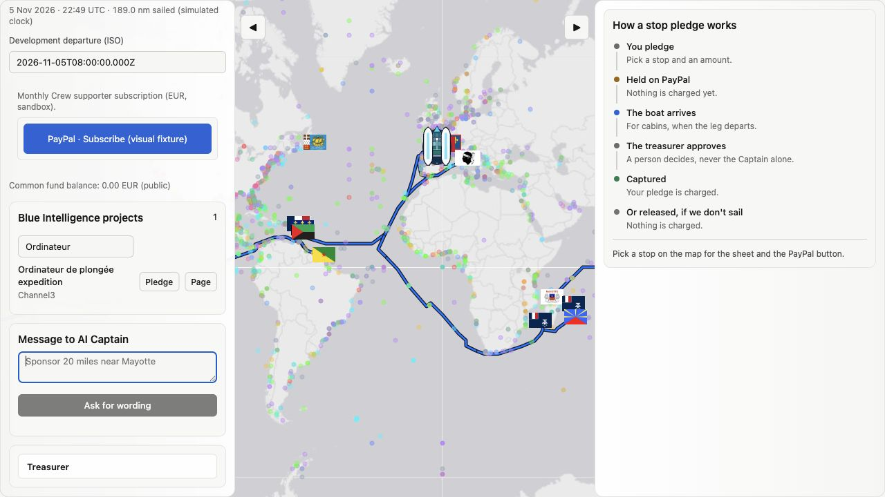
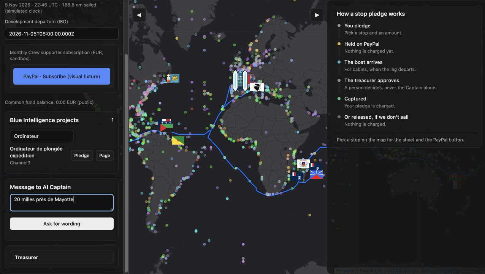
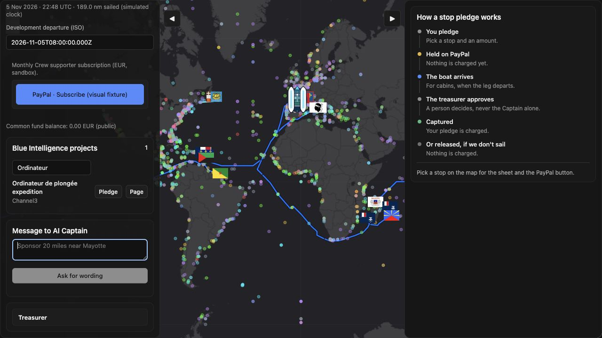

# Panel polish visual checks

Before: `2054a09` on `test/integration-2`. After: the changes in this PR.
Both sidebars are shown together at the same 1280 × 720 viewport, in light and dark.
The project filter is set to “Ordinateur” and the sidebar is scrolled to show Crew subscribe and the Captain input.

| Theme | Before | After |
| --- | --- | --- |
| Light |  |  |
| Dark |  |  |

The PayPal button is a labelled, local visual fixture: it renders inside the unchanged subscription host to show the frames, without loading PayPal or creating an order or subscription. The temporary fixture is outside the repository and is not included in the product. Map and route rendering use the actual application code.

Verified in both themes: sidebar width 340 px and tools width 420 px are unchanged; the tools panel now has an opaque token base beneath its existing gradient; Crew keeps only its inner host frame; the arrival dot uses the accent token; the English Captain field starts empty with a localized placeholder and disabled action. French placeholder and whitespace-only input behavior were also checked in the browser. At 390 px viewport width, the existing responsive layout has no horizontal document overflow.

Validation: 377 Vitest tests and 3 Node tests passed; frontend build passed (existing bundle-size warning); backend pytest 607 passed, 2 external-service tests skipped. PayPal files and `MapScene.jsx` are unchanged.
